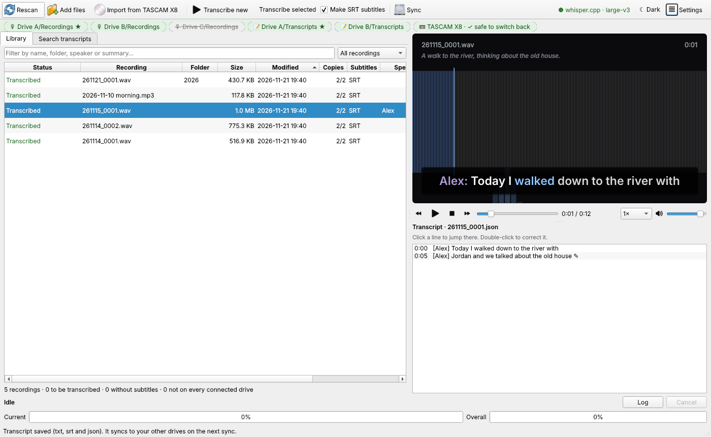
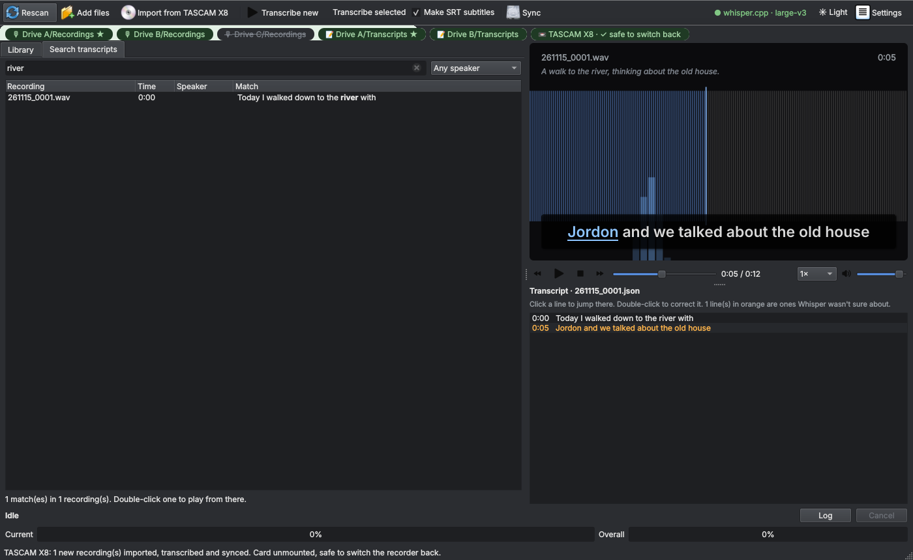

# Rambler

An audio-video transcription app for Linux that uses an NVIDIA GPU and Whisper to locally transcribe audio.



## Why

I have a TASCAM Portacapture X8 that I've been using to record an audio journal. I want transcripts of what I
record, but the Portacapture doesn't have any transcription built into it, so it's much easier to automate the
process.

The idea is: turn the TASCAM on and record something with it connected over USB. When the recording is done,
switch it to SD card reader mode. Rambler sees the card attach, recognizes it as one of its named recorders,
pulls the new recordings off the TASCAM into the sync directories, and creates the transcript and SRT for each
one. Then it syncs everything to every drive I have connected and unmounts the card so I can switch the
recorder back.

Everything runs locally on your own GPU. Nothing is uploaded anywhere.

## Install

Works on Ubuntu, Pop!_OS, Debian, Fedora and Arch (and their derivatives) with Python 3.10 or newer.
An NVIDIA GPU makes it fast; AMD/Intel GPUs and plain CPUs work too, just slower.

```bash
git clone https://github.com/akh13/Rambler.git && cd Rambler
./install.sh
```

`install.sh` puts Rambler in its own Python environment under `~/.local/share/rambler/`, adds `rambler` to your
PATH and Rambler to your app launcher, then runs `rambler setup`, which:

1. installs any missing system packages (ffmpeg and a Qt library, plus build tools if it needs to compile)
   through apt, dnf or pacman, asking for your password once
2. sets up the transcription engine:
   - **NVIDIA:** [faster-whisper](https://github.com/SYSTRAN/faster-whisper) with NVIDIA's CUDA libraries from
     pip. Nothing to compile and no CUDA toolkit needed, just the normal NVIDIA driver.
   - **AMD/Intel or no GPU:** builds [whisper.cpp](https://github.com/ggml-org/whisper.cpp) (Vulkan or CPU).
3. downloads the Whisper models (large-v3 and large-v3-turbo, about 4.7 GB; resumable if interrupted)

The first run takes 10–20 minutes, mostly downloading. If you skip it, Rambler offers the same setup on first
launch with a progress window, and Settings → Transcription → *Set up engine* runs it any time.

```bash
SKIP_ENGINE=1 ./install.sh                              # app only, set up the engine later
rambler setup --models large-v3-turbo                   # just the faster, smaller model
rambler setup --backend vulkan                          # AMD/Intel GPU
rambler setup --backend cpu --models small              # no GPU: pick a small model
rambler setup --no-packages                             # don't touch the system package manager
```

**Updating:** `cd Rambler && git pull && SKIP_ENGINE=1 ./install.sh`

**Uninstalling:** delete `~/.local/share/rambler`, `~/.config/rambler`, `~/.cache/rambler`,
`~/.local/bin/rambler` and `~/.local/share/applications/io.github.akh13.Rambler.desktop`. Your recordings and
transcripts are never touched.

Settings live in `~/.config/rambler/config.json`.

## Troubleshooting

**Rambler won't start: "Could not load the Qt platform plugin xcb".** The Qt cursor library is missing.
Ubuntu/Debian: `sudo apt install libxcb-cursor0` · Fedora: `sudo dnf install xcb-util-cursor` ·
Arch: `sudo pacman -S xcb-util-cursor`.

**Transcription is very slow on an NVIDIA machine.** Check the driver first: `nvidia-smi` should list your GPU.
If it doesn't, install your distro's proprietary NVIDIA driver and reboot (the CUDA toolkit is *not* needed).
If the driver is fine, `rambler setup --force` reinstalls the CUDA libraries Rambler uses.

**"Out of memory" or very slow transcription on a smaller GPU.** Lower the batch size in Settings →
Transcription (it also halves itself automatically), or switch the model to large-v3-turbo.

**My recorder or card doesn't show up.** Put the recorder in its USB drive / card reader mode and run
`rambler recorders`. It lists every removable volume it can see and which recorder it matches. If your card
shows with a different label, add it in Settings → Recorders → *Add from connected card*. Rambler mounts
cards itself if your desktop doesn't, so you don't need to open a file manager first.

**A transcript says "Too short".** Clips under 2 seconds (accidental presses) are skipped on purpose. Whisper
only invents text for them.

**Something else.** Open the *Log* panel at the bottom of the window; it records every step and error. When
opening an issue, include the output of `rambler status` and `rambler recorders`.

## How it works

**Recorders (TASCAM X8 and friends).** Settings → Recorders. Rambler ships with a TASCAM X8 entry that matches
the card by its volume label, `X8` (what the Portacapture calls its card in SD CARD READER mode). Plug the
recorder in while it's in card reader mode and click *Add from connected card* to pin your card by filesystem
UUID as well. When the card mounts, Rambler:

1. copies every recording it hasn't imported before into `<primary recording folder>/TASCAM X8/`, keeping the
   card's folder layout and the recorder's file names (`UTILITY/` is skipped). The card is only ever read.
2. remembers each imported file (name, size, date) so it never pulls the same take twice, even after you've
   moved or renamed things in your library. If the recorder's file counter was reset and a new take reuses an old
   name, it's imported alongside as `name (2).wav` rather than over the top.
3. transcribes everything new with SRTs, syncs all connected drives, then flushes and unmounts the card and
   tells you it's safe to switch the recorder back.

If your desktop doesn't mount drives until you open them (COSMIC, some minimal setups), Rambler mounts the
card itself through udisks, the same way the file manager would, and leaves it alone once it has unmounted it.

Any recorder or camera that shows up as a USB drive works the same way: add it with its label or UUID.


**Folders.** You list any number of recording folders and transcript folders (Settings → Folders).
The first of each is primary. Folders on drives that aren't plugged in are shown struck through and skipped,
so nothing is ever written to an empty mount point.

**Library.** Every audio file found in any recording folder is listed. A recording counts as transcribed when
a `.txt` exists for it in a transcript folder, matched by mirrored path (`2026/261114_0001.wav` →
`2026/261114_0001.txt`), by whisper.cpp's default `261114_0001.wav.txt` naming, or by an unambiguous filename
match anywhere in the transcript tree. So existing transcripts are picked up as-is.

**Transcription.** Audio is decoded with ffmpeg to 16 kHz mono, run through `whisper-cli` (best available model
by default: large-v3 > large-v3-turbo > large-v2 > medium > …), with Silero VAD when its model is present.
Outputs go to the primary transcript folder, mirroring the recording's subfolders:

```
261114_0001.txt            plain transcript
261114_0001.srt            subtitles (when SRT is on)
261114_0001.rambler.json   source, size, duration, language, engine, model, timestamp
```

**Sync.** Additive only: nothing is ever deleted. Missing files are copied to every connected folder in the
group; when copies differ, the newest wins by default (or the largest; see Settings → Sync). Overwritten
copies are moved to `.rambler-replaced/<timestamp>/` on that drive first. Copies go through a temp file +
fsync + rename and keep their original timestamps. Same-size files whose mtimes differ (copied without
preserving times) are compared by a quick hash rather than recopied. exFAT/FAT's 2-second mtime resolution
is allowed for. You get a plan (what goes where, how much, free-space check) before anything is copied.

When you hit Sync and some recordings lack transcripts or SRTs, Rambler offers to generate them with the best
available model first.

**Drag and drop.** Drop files or folders onto the window (or use Add files). They're copied into the primary
recording folder (optionally a subfolder such as `Inbox`), then transcribed (+SRT) into the transcript folder
and synced to every other drive.

**Player.** Select a recording to load it; double-click to play. The recording's waveform sits behind the
subtitles (click anywhere on it to jump there), with level bars that move with the sound. Subtitles light up
word by word when the transcript has word timings. Space = play/pause, ←/→ = 5 s. Right-click a recording →
Open in VLC if you want the real thing.

**Search.** The *Search transcripts* tab searches every transcript at once: words, `"exact phrases"`, and the
last word matches as a prefix. Filter by speaker. Double-click a hit to play from that moment. The index lives
in `~/.cache/rambler/search.db` and only re-reads transcripts that changed, so it stays quick with thousands of
recordings. Same thing from a terminal: `rambler search walk by the river`.



**Corrections.** Lines Whisper wasn't sure about are shown in orange, and the unsure words are underlined in the
subtitles. Double-click a line to fix it; the `.txt`, `.srt` and `.json` are rewritten together (word timings
are kept where the word count matches), the search index updates, and the fix syncs to your other drives on the
next sync. New names you type in are offered as hotwords so they're spelled right next time.

**Speakers.** Select lines, right-click → *Set speaker*. Speakers show in the transcript, the subtitles, a
library column, the search filter, and the `.srt` as `[Name] text`.

**Summaries.** If something writes a `<name>.summary` next to a transcript (a local LLM summariser, say), Rambler
shows it in the library and on the player.

**Light and dark.** Follows the system by default; the toolbar button switches, and Settings → Appearance has
the rest (waveform, level bars, confidence marks).

**Open WebUI (optional).** Settings → Open WebUI: point it at your server, paste an API key, pick a knowledge
base. Rambler sends each transcript as a document (summary and speakers on top) and replaces it when you correct
it, so you can chat with your recordings. `rambler push-owui` does the same headless.

**Automation.** Settings → Automation: transcribe-and-sync when Rambler opens and/or whenever a configured drive
is plugged in (polled every few seconds), and start Rambler minimized at login so a recorder or drive plugged
in later is always caught. If you'd rather not keep the window around, run the headless watcher as a systemd
user service instead (`packaging/rambler-watch.service`); the two use a lock so they never work at the same time.

## Headless

```bash
rambler status -v                 # folders, engine, what's pending
rambler transcribe --sync         # transcribe everything pending, then sync
rambler transcribe --backfill-srt # also redo transcripts that have no SRT
rambler sync --dry-run
rambler recorders                 # what's plugged in, and which recorder it matches
rambler import                    # pull from a connected recorder now, transcribe, sync, unmount
rambler watch                     # stay running and do all of the above whenever a card or drive appears
rambler search "old house"        # search every transcript
rambler push-owui                 # send new/changed transcripts to Open WebUI
```

Handy in a systemd user timer or a udev-triggered unit.

## Development

```bash
pip install PySide6 pytest
python -m pytest tests                       # core logic, uses tests/fake_whisper_cli.py (no GPU/models needed)
QT_QPA_PLATFORM=offscreen python tests/gui_smoke.py /tmp   # GUI end to end, saves screenshots
python -m rambler                            # run from the source tree
```

`tests/fake_whisper_cli.py` mimics whisper-cli, so you can point Settings → whisper-cli at it to try the UI
without a GPU.

Code map: `config.py` (settings), `recorders.py` (card detection + import), `transcript.py` (segments, edits, speakers), `search.py` (FTS index), `peaks.py` (waveforms), `openwebui.py`, `setup_engine.py` (toolchain), `library.py` (scan + transcript matching), `engines.py` (whisper.cpp,
faster-whisper, model ranking), `pipeline.py` (write outputs, import drops), `syncer.py` (plan + copy),
`cli.py`, `gui/` (main window, player, settings, background worker).

## Third-party components

Rambler downloads these at setup time rather than bundling them: [whisper.cpp](https://github.com/ggml-org/whisper.cpp)
(MIT), OpenAI Whisper model weights in ggml format (MIT), Silero VAD (MIT). PySide6 / Qt is LGPLv3, installed
from PyPI as an unmodified dependency.

## License

Rambler is free software: you can redistribute it and/or modify it under the terms of the GNU General Public
License as published by the Free Software Foundation, either version 3 of the License, or (at your option) any
later version. See [LICENSE](LICENSE).
