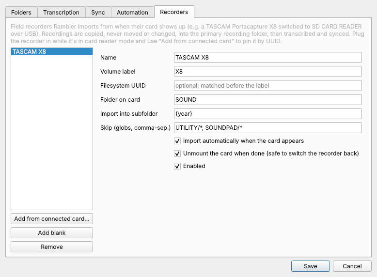

# Rambler

An audio-video transcription app for Linux that uses an NVIDIA GPU and Whisper to locally transcribe audio.


## Why

I have a TASCAM Portacapture X8 that I've been using to record an audio journal. I want transcripts of what I
record, but the Portacapture doesn't have any transcription built into it, so it's much easier to automate the
process.

The idea is: turn the TASCAM on and record something with it connected over USB. When the recording is done,
switch it to SD card reader mode. Rambler sees the card attach, recognizes it as one of its named recorders,
pulls the new recordings off the TASCAM into the sync directories, and creates the transcript and SRT for each
one. Then it syncs everything to every drive I have connected and unmounts the card so I can switch the
recorder back.

Everything runs locally on your own GPU. Nothing is uploaded anywhere.

## Install

```bash
git clone https://github.com/akh13/Rambler.git && cd Rambler
./install.sh
```

That's it. `install.sh` makes a venv, puts `rambler` on your PATH, adds a launcher entry, then runs
`rambler setup`, which:

1. installs whatever system packages are missing in one `sudo` prompt (git, cmake, build-essential, ffmpeg,
   libxcb-cursor0, plus the CUDA toolkit if you have an NVIDIA GPU and no `nvcc`; on Pop!_OS that's
   `system76-cuda-latest`, elsewhere `nvidia-cuda-toolkit`)
2. clones and builds whisper.cpp for your GPU (CUDA, Vulkan or CPU)
3. downloads large-v3, large-v3-turbo and the Silero VAD model from Hugging Face (resumable)

Everything lands in `~/.local/share/rambler/`. Nothing goes in the repo. If you skip it, the app offers the same
thing on first launch (with a progress window), and Settings → Transcription → Set up engine runs it any time.

```bash
SKIP_ENGINE=1 ./install.sh                          # app only
rambler setup --backend vulkan                      # no CUDA toolkit wanted
rambler setup --models large-v3-turbo --no-apt      # pick models, don't touch apt
rambler setup --ref v1.8.2 --force                  # pin/rebuild a specific whisper.cpp
```

Settings live in `~/.config/rambler/config.json`.

## How it works

**Recorders (TASCAM X8 and friends).** Settings → Recorders. Rambler ships with a TASCAM X8 entry that matches
the card by its volume label, `X8` (what the Portacapture calls its card in SD CARD READER mode). Plug the
recorder in while it's in card reader mode and click *Add from connected card* to pin your card by filesystem
UUID as well. When the card mounts, Rambler:

1. copies every recording it hasn't imported before into `<primary recording folder>/TASCAM X8/`, keeping the
   card's folder layout and the recorder's file names (`UTILITY/` is skipped). The card is only ever read.
2. remembers each imported file (name, size, date) so it never pulls the same take twice, even after you've
   moved or renamed things in your library. If the recorder's file counter was reset and a new take reuses an old
   name, it's imported alongside as `name (2).wav` rather than over the top.
3. transcribes everything new with SRTs, syncs all connected drives, then flushes and unmounts the card and
   tells you it's safe to switch the recorder back.

Any recorder or camera that shows up as a USB drive works the same way: add it with its label or UUID.



**Folders.** You list any number of recording folders and transcript folders (Settings → Folders).
The first of each is primary. Folders on drives that aren't plugged in are shown struck through and skipped,
so nothing is ever written to an empty mount point.

**Library.** Every audio file found in any recording folder is listed. A recording counts as transcribed when
a `.txt` exists for it in a transcript folder, matched by mirrored path (`2026/261114_0001.wav` →
`2026/261114_0001.txt`), by whisper.cpp's default `261114_0001.wav.txt` naming, or by an unambiguous filename
match anywhere in the transcript tree. So existing transcripts are picked up as-is.

**Transcription.** Audio is decoded with ffmpeg to 16 kHz mono, run through `whisper-cli` (best available model
by default: large-v3 > large-v3-turbo > large-v2 > medium > …), with Silero VAD when its model is present.
Outputs go to the primary transcript folder, mirroring the recording's subfolders:

```
261114_0001.txt            plain transcript
261114_0001.srt            subtitles (when SRT is on)
261114_0001.rambler.json   source, size, duration, language, engine, model, timestamp
```

**Sync.** Additive only: nothing is ever deleted. Missing files are copied to every connected folder in the
group; when copies differ, the newest wins by default (or the largest; see Settings → Sync). Overwritten
copies are moved to `.rambler-replaced/<timestamp>/` on that drive first. Copies go through a temp file +
fsync + rename and keep their original timestamps. Same-size files whose mtimes differ (copied without
preserving times) are compared by a quick hash rather than recopied. exFAT/FAT's 2-second mtime resolution
is allowed for. You get a plan (what goes where, how much, free-space check) before anything is copied.

When you hit Sync and some recordings lack transcripts or SRTs, Rambler offers to generate them with the best
available model first.

**Drag and drop.** Drop files or folders onto the window (or use Add files). They're copied into the primary
recording folder (optionally a subfolder such as `Inbox`), then transcribed (+SRT) into the transcript folder
and synced to every other drive.

**Player.** Select a recording to load it; double-click to play. Subtitles show over the black screen like VLC,
and the cue list underneath jumps to any line. Space = play/pause, ←/→ = 5 s. Right-click → Open in VLC if
you want the real thing.

**Automation.** Settings → Automation: transcribe-and-sync when Rambler opens and/or whenever a configured drive
is plugged in (polled every few seconds), and start Rambler minimized at login so a recorder or drive plugged
in later is always caught. If you'd rather not keep the window around, run the headless watcher as a systemd
user service instead (`packaging/rambler-watch.service`); the two use a lock so they never work at the same time.

## Headless

```bash
rambler status -v                 # folders, engine, what's pending
rambler transcribe --sync         # transcribe everything pending, then sync
rambler transcribe --backfill-srt # also redo transcripts that have no SRT
rambler sync --dry-run
rambler import                    # pull from a connected recorder now, transcribe, sync, unmount
rambler watch                     # stay running and do all of the above whenever a card or drive appears
```

Handy in a systemd user timer or a udev-triggered unit.

## Development

```bash
pip install PySide6 pytest
python -m pytest tests                       # core logic, uses tests/fake_whisper_cli.py (no GPU/models needed)
QT_QPA_PLATFORM=offscreen python tests/gui_smoke.py /tmp   # GUI end to end, saves screenshots
python -m rambler                            # run from the source tree
```

`tests/fake_whisper_cli.py` mimics whisper-cli, so you can point Settings → whisper-cli at it to try the UI
without a GPU.

Code map: `config.py` (settings), `recorders.py` (card detection + import), `setup_engine.py` (toolchain), `library.py` (scan + transcript matching), `engines.py` (whisper.cpp,
faster-whisper, model ranking), `pipeline.py` (write outputs, import drops), `syncer.py` (plan + copy),
`cli.py`, `gui/` (main window, player, settings, background worker).

## Third-party components

Rambler downloads these at setup time rather than bundling them: [whisper.cpp](https://github.com/ggml-org/whisper.cpp)
(MIT), OpenAI Whisper model weights in ggml format (MIT), Silero VAD (MIT). PySide6 / Qt is LGPLv3, installed
from PyPI as an unmodified dependency.

## License

Rambler is free software: you can redistribute it and/or modify it under the terms of the GNU General Public
License as published by the Free Software Foundation, either version 3 of the License, or (at your option) any
later version. See [LICENSE](LICENSE).
